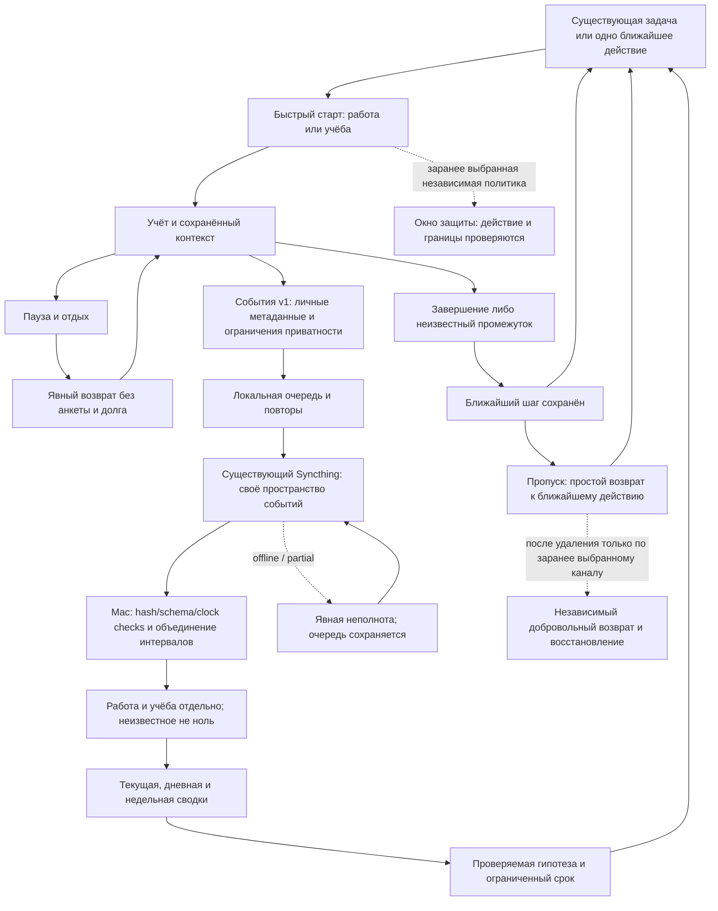

# Сквозной цикл — актуальный объём ProductiveLauncher

По последнему решению пользователя собственная защита выбранных сайтов/браузеров и приложений снова входит в объём. Новая политика и её фактическое действие должны быть проверены; лабораторные пробы не подтверждают готовую защиту.

## Границы и текущая готовность

- Mac .app и Android используют общий контракт событий и номинальную цель25мин; пауза не превращается в работу, контекст остаётся после остановки. Сводка не доказывает внимание.
- Syncthing уже существовал, но его актуальность проверяется заново. Историческая документация не доказывает текущую связь. Новый транспорт пишет только собственное пространство, без дневников/БД/ключей; `taskRef` v1 может содержать читаемый личный slug. USB — лабораторный путь, не обязательная повседневная зависимость.
- Собственная защита снова в объёме, но новое календарное окно пока не доказано как действующая блокировка. Прежний короткий root-helper был удалён; DNS-проба имела ограниченный охват. Cold Turkey исключён. Не подменять реальное действие галочкой; сохранять сеть и предусмотренный выход.
- Существующая необязательная app-gate сохраняется, но не является входной платой к задачам/учёту. Ритуал/дневник — самостоятельные полезные инструменты, не обязательная длинная анкета.
- Независимые локальные review/receiver/context процессы уже реально запускались и снимались с сохранением истории. Loopback не открывается в LAN. Возврат после удаления всего контура и неподтверждённый внешний канал не обещаются.
- Канал независимого добровольного возвращения после полного удаления ещё требует явного выбора; без него продукт не может сообщить о себе из удалённого приложения.

Доказательства/открытые критерии: [ACCEPTANCE.md](ACCEPTANCE.md), [DEVELOPMENT-STATUS.md](../DEVELOPMENT-STATUS.md). Научные основания отдельных приёмов и пределы переноса: [EVIDENCE-TO-DESIGN.md](EVIDENCE-TO-DESIGN.md).
