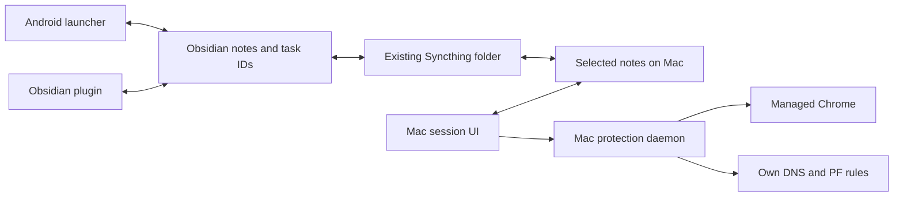

# Архитектура и потоки данных

## Компоненты

Это схема ролей, а не обещание автоматической настройки всех соединений. Vault и базы устройств — личные runtime-данные, не исходники проекта. Syncthing уже является внешним транспортом файлов; FocusDeck не заменяет его настройку или сеть телефона.

| Дерево | Ответственность |
|---|---|
| `app/` | Android UI/ViewModel, Room для локальных данных, SAF-доступ к vault, задачи/дневник/связи/сеансы и обмен |
| `guard/`, Android `domainfilter/` | Сохранённые legacy/QA-эксперименты собственной защиты; нормальный Android-режим использует Stay Focused |
| `obsidian-plugin/focusdeck-panel/` | Панель и изменения тех же заметок внутри Obsidian |
| `macos-study/Sources/` | SwiftUI, состояние сеанса, отчёты, task binding и управление локальными компонентами |
| `macos-study/system-protection/` | Независимый root-ledger, IPC, выбранные приложения, DNS/PF и браузерный прокси |
| `shared/` | Схема событий, правила сеансов/окон и Swift-каталог задач |
| `integration/` | Проверки совместимости и обезличенные fixtures |
| `harness/` | Необязательный сбор/обмен/сводки; наличие кода не означает включённый личный контур |
| `architecture-workboard/` | Отдельный Atlas/Roslyn/React Flow инструмент анализа C#, не зависимость мобильного лаунчера |

## Единственный статус задачи

Задачи хранятся в обычных daily notes Obsidian. Чекбокс остаётся единственным местом выполнения задачи; сеанс и попытка ответа не должны самостоятельно подменять его статус. Устойчивые task ID связывают запись, сеанс и интерфейс; номер строки и одинаковый заголовок не являются надёжной идентичностью.

Android записывает daily через [VaultDayStore](../../app/src/main/java/dev/stanislav/focusdeck/data/vault/VaultDayStore.kt) и [DailyNoteParser](../../app/src/main/java/dev/stanislav/focusdeck/data/vault/DailyNoteParser.kt). На Mac выбор и завершение связаны с [ObsidianTaskCatalog](../../shared/ObsidianTaskCatalog.swift). Код плагина работает внутри Obsidian vault. Внешние изменения и конфликты синхронизации нельзя считать автоматически разрешёнными.

## Сеанс и защита

Таймер/рабочий интервал, факт завершения задачи и срок системного запрета независимы. Изменение задачи или остановка учёта не должны обнулять выбранное защитное окно. Одинаковый JSON-контракт не доказывает одновременный старт двух устройств или работающую доставку.

На Android есть Room-модели и миграции сеансов. Root-состояние Mac хранится в отдельном root-private ledger и его backup; UI получает типизированные ответы по Unix socket. [SystemProtectionProtocol.swift](../../macos-study/Sources/SystemProtectionProtocol.swift) задаёт пути и сообщения, [Commitment.swift](../../macos-study/system-protection/Commitment.swift) — сохранение остатка/ожидания выхода.

## События и необязательный обмен

[shared/README.md](../../shared/README.md) описывает JSONL, UTC, eventId/sessionId, taskRef, category, evidence, неизвестность и исключение двойного учёта пересечений. Схема — [event-v1.schema.json](../../shared/event-v1.schema.json); правила — [session-policy-v1.json](../../shared/session-policy-v1.json) и [window-policy-v2.json](../../shared/window-policy-v2.json).

В Android сохранены outbox, SAF publisher/reader и sync client/job; на Mac — локальный receiver/report reader и harness. Включение этого дополнительного контура, его права и хранилище требуют собственной конфигурации. Базовый файловый обмен заметками не означает, что системный root-запрет Mac синхронизирован с Android.

Нельзя считать время в приложении концентрацией, отсутствие heartbeat удалением, completed подтверждением полезного результата или неизвестный интервал нулевой работой. Сырые тексты окон, клавиатура и личный vault не нужны для публикации кода.

## Границы и дальнейшее развитие

Реальная двусторонняя доставка и её условия описаны в [датированном отчёте 4 ноября](../SEAMLESS-SYNC-20261104.md). Личные задачи в Git не копируются. Учебная очередь вопросов, if–then и дыхание остаются [запланированными карточками](../PRODUCT-INCREMENTS.md), даже при наличии обычного сохранения задачи и таймера.

Архивные эксперименты сохраняются как исходники, но актуальный путь сборки Mac — System 0.12.2, Android-защита — внешний Stay Focused. Политика платформы и доступ пользователя к root ограничивают достижимую стойкость.
